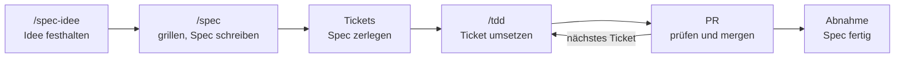

# deepbrook-prozess

Skills, Prozessregeln und Vorlagen, mit denen du ein Software- oder Spielprojekt zusammen mit [Claude Code](https://claude.com/claude-code) planst und baust. Ein Befehl richtet ein neues Projekt komplett ein: GitHub-Repo, Ordner, Kanban-Board, Labels und die Skills, die Claude durch den Ablauf führen.

## Worum es geht

Wer mit einer KI programmiert, verliert schnell den Überblick: Was war entschieden, was ist fertig, was fehlt noch? Dieser Prozess hält dagegen mit **Spec-Driven Development**:

- **Erst beschreiben, dann bauen.** Jede größere Änderung beginnt als **Spec**, eine kurze Beschreibung in `docs/specs/`: was der Nutzer danach kann, was dazugehört und woran man erkennt, dass es fertig ist (Abnahmekriterien).
- **Kleine Schritte.** Eine Spec wird in **Tickets** zerlegt (GitHub-Issues). Jedes Ticket ist ein dünner Schnitt, der für sich funktioniert und sich testen lässt.
- **Alles sichtbar.** Specs und Tickets liegen auf einem **Kanban-Board**; Claude zieht die Karten selbst mit, sobald sich etwas tut.
- **Du entscheidest.** Claude fragt nach, schlägt vor und setzt um. Was gebaut wird und wann etwas fertig ist, bestimmst du.

## Der Ablauf



1. **`/spec-idee`**: Du erzählst eine Idee. Claude legt dafür ein Spec-Issue an (Label `ready-to-grill`) und stellt es in die Spalte Specs.
2. **`/spec #<nr>`**: Claude erkennt am Label, wo die Spec steht, und macht den nächsten Schritt:
   - **Grillen:** Claude stellt dir Fragen, bis die Idee klar ist, und schreibt die Spec nach `docs/specs/` (Label `ready-to-slice`). Du mergst den Pull Request mit der Spec.
   - **Slicen:** Claude zerlegt die Spec in Tickets und hängt sie als Unter-Issues an das Spec-Issue (Label `sliced`). Tickets mit `ready-for-agent` darf Claude allein umsetzen, Tickets mit `ready-for-human` brauchen dich (Grafik, Entscheidung, Test am Gerät).
3. **Ticket umsetzen**: Sag zum Beispiel „Weiter mit #12“. Claude legt einen Branch an, baut testgetrieben (Skill `tdd`) und öffnet einen Pull Request. Du schaust ihn an und mergst ihn.
4. **Abnahme**: Sind alle Tickets erledigt, rufst du noch einmal `/spec #<nr>` auf. Claude prüft mit dir die Abnahmekriterien; danach ist die Spec erledigt.

**Tipp fürs Board:** Sortier die Ansicht nach Labels absteigend (▾ neben dem Ansichtsnamen → Sort by → Labels). Dann steht in der Spalte Specs oben, was schon Tickets hat (`sliced`), darunter `ready-to-slice` und `ready-to-grill`. Blende außerdem das Feld „Sub-issues progress“ ein (▾ → Fields): Es zeigt je Spec, wie viele Tickets erledigt sind; ist es voll, ist die Spec reif für die Abnahme.

Konzeptbilder, Notizen oder PDFs legst du jederzeit in den Ordner `inbox/`. Claude schaut dort nach und übernimmt passende Dateien in Spec oder Ticket.

## Voraussetzungen

- ein **GitHub-Konto** ([registrieren](https://github.com/signup))
- **Claude Code** ([Installation](https://docs.claude.com/en/docs/claude-code/setup))
- **Git**, **Node.js** und die **GitHub CLI `gh`**, bei GitHub angemeldet mit den Berechtigungen `repo` und `project`

Fehlt etwas davon, ist das kein Problem: Das Setup prüft alles, erklärt jeden fehlenden Schritt und installiert auf deine Erlaubnis hin selbst. Nur Node.js brauchst du schon für die Installation unten:

- **Windows:** Öffne die PowerShell **als Administrator** (Rechtsklick auf Start → „Terminal (Administrator)“) und gib ein: `winget install --id OpenJS.NodeJS.LTS -e`
- **macOS:** `brew install node`
- **sonst:** [nodejs.org](https://nodejs.org/)

**Schließ danach das Terminal und öffne ein neues.** Erst das neue Terminal kennt `node` und `npx`; im alten kommt sonst die Meldung, der Befehl sei nicht gefunden.

## Loslegen

**Einmal pro Rechner** installierst du den Setup-Skill (in einem Terminal):

```sh
npx skills add DeepBrookLabs/deepbrook-prozess --skill projekt-anlegen -g -a claude-code -y
```

**Pro Projekt:** Leg einen Ordner an (oder nimm den Ordner eines bestehenden Projekts), starte darin Claude Code und gib ein:

```
/projekt-anlegen
```

Das Setup

1. prüft die Voraussetzungen,
2. fragt nach Name, GitHub-Konto, einer kurzen Vision und der Projektart (Spiel oder Anderes),
3. fasst alles zusammen und legt erst nach deinem Ja los: Repo, Ordner und Vorlagen, Labels, Kanban-Board und Skills.

Jeder Schritt läuft zuerst als Trockenlauf, du siehst also vorher, was passiert. In einem bestehenden Repo ändert das Setup vorhandene Dateien, Labels oder Boards nur nach Rückfrage.

Danach startest du Claude Code neu, damit es die Skills lädt, und hältst die erste Idee mit `/spec-idee` fest.

## Skills aktuell halten

Das Setup legt die Skills im Projekt unter `.claude/skills/` ab; welcher Stand installiert ist, steht in `skills-lock.json`. Neue Versionen der Prozess-Skills holst du im Projektordner mit:

```sh
npx skills update
```

Prüf danach mit `git status`, was sich geändert hat, und committe es. Ein Update kann die Skills nach `.agents/skills/` verschieben; `.claude/skills/` verweist dann nur noch darauf (unter Windows als Verknüpfung, eine sogenannte Junction). **`.agents/` gehört dann mit ins Repo und darf nicht gelöscht werden**, sonst fehlen die Skills.

## Was im Paket steckt

| Pfad | Inhalt |
|---|---|
| `skills/projekt-anlegen/` | das Setup: Gesprächsführung, Skripte, Vorlagen für neue Projekte |
| `skills/prozess/` | Regeln für Board, Labels, Tickets und PRs |
| `skills/spec-idee/`, `skills/spec/` | der Spec-Ablauf |
| `skills/to-tickets/` | Spec in Tickets zerlegen |
| `GLOSSARY.md` | Begriffe des Prozesses |

Dazu installiert das Setup ausgewählte Skills von [mattpocock/skills](https://github.com/mattpocock/skills), zum Beispiel `grilling`, `tdd`, `pr` und `code-review` (Liste in `skills/projekt-anlegen/scripts/skills.json`).

## Lizenz

[MIT](LICENSE), Copyright (c) 2026 Markus Schwinn.

Einige Teile stammen aus [mattpocock/skills](https://github.com/mattpocock/skills) (MIT, Copyright (c) 2026 Matt Pocock) und tragen dessen Hinweis:

- `skills/to-tickets/` (angepasst; Lizenztext in [`skills/to-tickets/LICENSE`](skills/to-tickets/LICENSE))
- die Vorlagen `docs/agents/issue-tracker.md` und `docs/agents/triage-labels.md` unter `skills/projekt-anlegen/vorlagen/projekt/`
